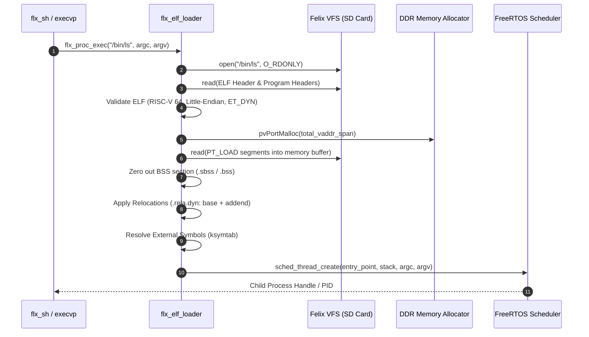

# Felix OS Architecture: Dynamic Loading, Shared Libraries & Configurability

## 1. Executive Summary & Architectural Motivation

Previously, Felix OS was structured as a **monolithic firmware image**: the Microchip HAL, FreeRTOS kernel, POSIX shims, Virtual File System (VFS), drivers, and Toybox command-line utilities were all compiled and statically linked into a single ELF executable.

On the Microchip PolarFire SoC Discovery Kit, this approach hit a severe memory wall when targeting the 512 KB L2 Scratchpad Memory (LIM):
- Including Toybox utilities bloated the text segment past the 512 KB limit.
- To fit in LIM, the heap was artificially constricted to `1k`, and almost all command-line toys had to be excluded.

This design document establishes the architecture to transition Felix OS from a monolithic binary into a **modular, dynamically configurable operating system platform**:
1. **Configurability via Kconfig:** A unified configuration engine to compile specialized OS profiles (e.g. Minimal LIM Real-Time OS vs. Full DDR Interactive Workstation vs. Asymmetric Multiprocessing) from a single codebase.
2. **Position-Independent Dynamic ELF Loader:** A lightweight in-kernel ELF loader capable of loading standalone user applications from the FAT32 SD card into dynamic RAM at runtime.
3. **Dynamic Shared Libraries (DLL / `.so`):** A runtime symbol resolution engine enabling both "Kernel-as-libc" execution for microscopic user binaries and loadable extension modules/drivers via `dlopen()` and `dlsym()`.

---

## 2. Configurability Subsystem (Kconfig)

Felix will adopt the industry-standard **Kconfig** system (used by Linux, Zephyr, NuttX, and Toybox) to manage build profiles, subsystem dependencies, and compile-time constants.

### 2.1 Leveraging In-Tree Tooling
Toybox already includes an in-tree, portable C implementation of Kconfig under [`felix/external/toybox/kconfig/`](file:///c:/git/bar/felix/external/toybox/kconfig/). Felix will invoke these tools to process configuration menus and generate an `autoconf.h` header for the C preprocessor.

### 2.2 Core Kconfig Symbols
```kconfig
menu "Target Architecture & Memory Model"

config FELIX_PLATFORM_DISCOVERY_KIT
    bool "Microchip PolarFire SoC Discovery Kit (MPFS-DISCO-KIT)"
    default y

choice
    prompt "Primary Memory Target"
    default FELIX_MEM_DDR

config FELIX_MEM_LIM
    bool "LIM Only (512 KB SRAM)"
    help
      Run monolithic kernel entirely out of 512 KB L2 scratchpad memory.
      Disables dynamic ELF loading and external modules.

config FELIX_MEM_DDR
    bool "DDR Memory (1 GB Cached)"
    help
      Run kernel and user applications from DDR memory space (0x80000000).

config FELIX_MEM_AMP
    bool "Asymmetric Multiprocessing (AMP)"
    help
      Harts 1-3 run deterministic control tasks from LIM.
      Hart 4 runs Felix OS supervisor with DDR and Toybox.
endchoice

endmenu

menu "Executable & Dynamic Loading"

config FELIX_ELF_LOADER
    bool "Enable Position-Independent ELF Loader"
    depends on FELIX_MEM_DDR || FELIX_MEM_AMP
    default y
    help
      Enables loading external user binaries from VFS (/bin) into dynamic RAM.

config FELIX_SHARED_LIBRARIES
    bool "Enable Dynamic Shared Libraries & Plugins (dlopen/dlsym)"
    depends on FELIX_ELF_LOADER
    default y
    help
      Enables runtime symbol resolution and dynamic module loading.

endmenu

menu "POSIX Subsystems"

config FELIX_FREERTOS_POSIX
    bool "Enable FreeRTOS+POSIX Engine"
    default y

config FELIX_VFS_FAT32
    bool "Enable FAT32 SD Card Filesystem"
    default y

endmenu
```

### 2.3 Predefined Build Profiles (Defconfigs)
1. **`disco_lim_defconfig` (Minimal Real-Time Profile):**
   - Target: LIM Only (<150 KB footprint).
   - Dynamic loader disabled; all tasks statically compiled.
   - Heap: 32 KB; hard real-time determinism.
2. **`disco_ddr_defconfig` (Interactive Workstation Profile):**
   - Target: DDR (1 GB address space).
   - Dynamic ELF loader enabled; full POSIX and VFS enabled.
   - Applications loaded dynamically from `/bin` on SD card.
3. **`disco_amp_defconfig` (Heterogeneous Multi-Hart Profile):**
   - Harts 1–3 assigned to LIM real-time control.
   - Hart 4 assigned to DDR Felix supervisor.

---

## 3. Position-Independent Dynamic ELF Loader (`flx_elf_loader`)

### 3.1 Binary Format: Static PIE (Position-Independent Executable)
In embedded RISC-V without virtual memory page tables enabled (flat physical addressing), executables cannot be linked to a fixed virtual address (such as `0x10000` or `0x80000000`). If two programs run concurrently, or memory fragments over time, their load addresses must be determined dynamically.

Felix adopts **Static PIE (`ET_DYN`)**:
- Toolchain flags: `-fPIE -pie -static-pie` (native in `riscv64-unknown-elf-gcc`).
- Addressing: Uses PC-relative instructions (`auipc`, `jalr`) for local code/data references.
- External data and function addresses are addressed via the Global Offset Table (GOT).
- All absolute memory references are recorded in the relocation table (`.rela.dyn`) with relocation type `R_RISCV_RELATIVE`.

### 3.2 Loading Pipeline
When `execvp(path, argv)` or `flx_proc_exec(path, argc, argv)` is invoked:



### 3.3 Relocation Processing on RV64
For Position-Independent Executables on RV64, the loader implements relocation handling for:
- `R_RISCV_RELATIVE`: Target address in GOT or pointer data is patched by adding the physical load base:
  $$\text{Target} = \text{LoadBase} + \text{Addend}$$
- `R_RISCV_64`: 64-bit absolute symbol relocation against exported kernel symbol table.
- `R_RISCV_JUMP_SLOT`: Procedure Linkage Table (PLT) dynamic function resolution.

---

## 4. Dynamic Shared Libraries & Plugins (DLL / `.so`)

### 4.1 Model 1: "Kernel-as-libc" Symbol Export Table
Rather than requiring a bloated, separate `libc.so` binary on the SD card, **the Felix kernel itself acts as the primary shared library**:
* The kernel compiles with standard C library support, FreeRTOS, and POSIX shims.
* The kernel maintains a compact exported symbol array:
  ```c
  typedef struct {
      const char *name;
      const void *addr;
  } flx_symbol_t;

  static const flx_symbol_t flx_ksymtab[] = {
      {"printf",          (void *)&printf},
      {"malloc",          (void *)&malloc},
      {"free",            (void *)&free},
      {"open",            (void *)&open},
      {"read",            (void *)&read},
      {"write",           (void *)&write},
      {"close",           (void *)&close},
      {"pthread_create",  (void *)&pthread_create},
      {"pthread_mutex_lock", (void *)&pthread_mutex_lock},
      {NULL, NULL}
  };
  ```
* **Impact:** User binaries (like `/bin/cat`, `/bin/grep`, or custom user scripts) don't link their own copies of `printf` or FreeRTOS. User binaries shrink to **2 KB – 10 KB**, preserving storage and loading in milliseconds.

### 4.2 Model 2: Runtime Plugins via `dlopen()` & `dlsym()`
For loading peripheral drivers, communication protocols, or custom diagnostic tools at runtime:
- `void *dlopen(const char *filename, int flag);`
  - Loads an ELF shared object (`.so`) into DDR.
  - Relocates it against `flx_ksymtab`.
  - Executes the `.init` / `__init()` constructor function.
- `void *dlsym(void *handle, const char *symbol);`
  - Looks up symbol address from the loaded ELF's dynamic symbol table (`.dynsym`).
- `int dlclose(void *handle);`
  - Executes `.fini` destructors and frees the allocated memory back to the DDR heap.

---

## 5. Interaction with Shell & Process Model

The existing shell architecture in [`felix/shell/flx_sh.c`](file:///c:/git/bar/felix/shell/flx_sh.c#L79-L87) is already prepared for this:
1. When a user inputs a command in `flx_sh`:
   - Built-ins (`cd`, `history`, `exit`) execute in-process.
   - Any external command is forwarded to `execvp(argv[0], argv)`.
2. [`felix/posix/execvp.c`](file:///c:/git/bar/felix/posix/execvp.c) searches `$PATH` (defaulting to `/bin`).
3. `execvp()` calls `flx_proc_exec(target_path, argc, argv)`.
4. `flx_proc_exec()` delegates directly to `flx_elf_loader_exec()`.
5. The child task executes concurrently (or synchronously if foreground).
6. When the child calls `exit(code)`, the PCB is torn down, file descriptors are flushed, and allocated DDR memory blocks are returned to FreeRTOS.

---

## 6. Implementation Roadmap

| Phase | Milestone | Deliverables |
| :--- | :--- | :--- |
| **Phase 1** | **Kconfig Infrastructure** | Integrate `toybox/kconfig` tooling into Felix build; create root `Kconfig` and initial defconfigs (`disco_lim_defconfig`, `disco_ddr_defconfig`). |
| **Phase 2** | **Kernel Symbol Table (`ksymtab`)** | Implement symbol registration macro `FLX_EXPORT_SYMBOL()` and kernel lookup engine. |
| **Phase 3** | **Static PIE ELF Loader Core** | Implement `flx_elf_load()`: ELF header parsing, segment allocation in DDR, `.rela.dyn` relocation engine. |
| **Phase 4** | **`execvp` Shell Integration & Standalone Toybox** | Wire `flx_proc_exec()` to the ELF loader. Build Toybox as an external `/bin/toybox` multicall binary on SD card. |
| **Phase 5** | **`dlopen()` / `dlsym()` Dynamic Extension** | Expose POSIX dynamic library API for loadable drivers and runtime plugins. |
