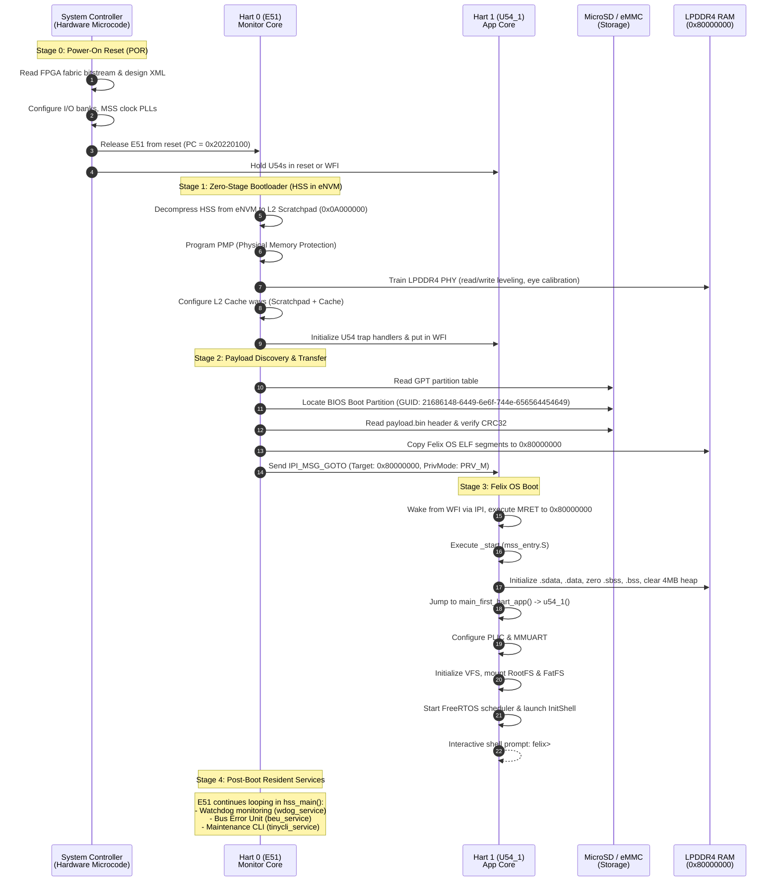
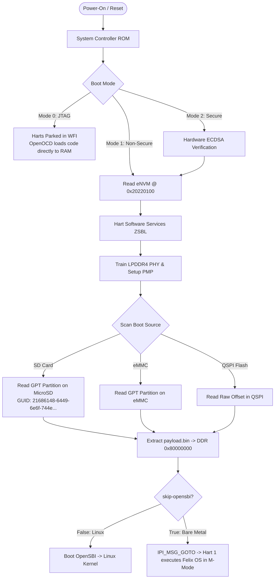

# PolarFire SoC Boot Architecture & Flow Guide

This document explains the complete boot hierarchy of the Microchip PolarFire SoC (MPFS) on the Discovery Kit (`MPFS-DISCO-KIT`), from silicon power-on to the interactive Felix OS shell prompt. It details the role of each hart, the boot stages, memory transitions, and specifically addresses **why Hart Software Services (HSS) continues running and how it can be managed or eliminated**.

---

## 1. Hardware Overview & Core Topology

The PolarFire SoC Microprocessor Subsystem (MSS) features five 64-bit RISC-V harts with asymmetric capabilities:

```
+-----------------------------------------------------------------------------------+
|                               PolarFire SoC MSS                                   |
|                                                                                   |
|  +--------------------+   +----------------------------------------------------+  |
|  |    Hart 0 (E51)    |   |           Harts 1 - 4 (U54_1 .. U54_4)             |  |
|  |  Monitor / Control |   |                 Application Cores                  |  |
|  |  RV64IMAC (No MMU) |   |        RV64GC (SV39 MMU + Double Precision FPU)    |  |
|  |  28 KB ITIM        |   |        28 KB ITIM per core                         |  |
|  |  8 KB DTIM         |   |        32 KB I$ / 32 KB D$ L1 cache per core       |  |
|  +---------+----------+   +-------------------------+--------------------------+  |
|            |                                        |                             |
|            +-------------------+--------------------+                             |
|                                |                                                  |
|  +-----------------------------v-----------------------------------------------+  |
|  |                    System Controller (Hardware Microcode)                   |  |
|  +-----------------------------+-----------------------------------------------+  |
|                                |                                                  |
|  +-----------------------------v-----------------------------------------------+  |
|  |                        2 MB L2 Shared Memory Subsystem                      |  |
|  |   - L2 Scratchpad (0x0A000000) - Used by HSS                                |  |
|  |   - L2 LIM (0x08000000)        - Loosely Integrated Memory                  |  |
|  |   - L2 Cache                   - Caching external DDR (0x80000000)          |  |
|  +-----------------------------+-----------------------------------------------+  |
|                                |                                                  |
|  +-----------------------------v-----------------------------------------------+  |
|  |             128 KB Embedded Non-Volatile Memory (eNVM @ 0x20220100)          |  |
|  +-----------------------------+-----------------------------------------------+  |
|                                |                                                  |
|  +-----------------------------v-----------------------------------------------+  |
|  |                   1 GB External LPDDR4 DRAM (0x80000000)                    |  |
|  +-----------------------------------------------------------------------------+  |
+-----------------------------------------------------------------------------------+
```

---

## 2. The Boot Stages: From Microcode to Felix OS



---

## 3. Detailed Stage Breakdown

### Stage 0: System Controller Microcode
- **Who runs it**: A dedicated hard-wired service processor inside the PolarFire SoC silicon (not visible as a general-purpose RISC-V core).
- **Duties**:
  1. Detects power rails stable (Power-On Reset).
  2. Reads user bitstream security keys and loads the FPGA fabric configuration from onboard SPI flash.
  3. Releases the reset line of Hart 0 (E51) with its Program Counter pointing to **eNVM base (`0x20220100`)**.
  4. Harts 1–4 are held in hardware reset or low-power state until awakened.

### Stage 1: Zero-Stage Bootloader (ZSBL / eNVM)
- **Who runs it**: Hart 0 (E51).
- **Physical Memory**: 128 KB of eNVM at `0x20220100` (first 256 bytes reserved for metadata).
- **Code executed**: Microchip Hart Software Services (HSS) or a custom bare-metal ZSBL.
- **Critical Duties**:
  1. **Clock & I/O Multiplexing**: Switches clocks from default RC oscillators to high-frequency PLLs.
  2. **DDR Training**: **External LPDDR4 cannot be accessed until dynamically trained.** HSS executes DDR PHY calibration routines (DQS gating, read/write leveling, VREF tuning).
  3. **L2 Cache Partitioning**: Configures the 2 MB L2 cache into 4 ways of Scratchpad (`0x0A000000`), 4 ways of LIM (`0x08000000`), and 8 ways of coherent L2 cache for DDR.
  4. **PMP Setup**: Programs Physical Memory Protection registers so application cores have RWX access to DDR memory.

### Stage 2: Payload Discovery & Loading
- **Storage Media**: MicroSD Card (MMC), onboard eMMC, or QSPI flash.
- **Partition Discovery**:
  - HSS inspects the GPT (GUID Partition Table) looking for a partition with Type GUID:
    `21686148-6449-6e6f-744e-656564454649` (ASCII: `"Hah!IdontNeedEFI"`).
  - HSS reads `payload.bin` directly from the raw sectors of that partition.
- **Payload Extraction**:
  - Validates header magic `0xb007c0de` and CRC32 checksums.
  - Copies binary chunks into LPDDR4 RAM at destination address `0x80000000`.
- **Handoff Mechanism**:
  - **Linux Flow**: HSS invokes OpenSBI (`IPI_MSG_OPENSBI_INIT`). OpenSBI runs in M-mode and boots Linux in S-mode.
  - **Bare-Metal / Felix OS Flow (`skip-opensbi: true`)**: HSS dispatches an Inter-Processor Interrupt (`IPI_MSG_GOTO`) to Hart 1. Hart 1 receives the IPI, sets `mepc = 0x80000000`, sets privilege mode to Machine Mode (`PRV_M`), and executes `mret` directly into Felix OS.

### Stage 3: Felix OS Initialization
- **Who runs it**: Hart 1 (U54_1) in Machine Mode (`PRV_M`).
- **Flow**:
  1. Enters `_start` in `mss_entry.S` at `0x80000000`.
  2. Because `MPFS_HAL_FIRST_HART = 1`, Hart 1 recognizes itself as the master application hart and bypasses the secondary-hart wait loop.
  3. Clears the 4 MB common heap, zeroes `.bss` and `.sbss`, and copies `.data` to RAM.
  4. Calls `main_first_hart_app()` -> `u54_1()`.
  5. Initializes PLIC interrupts, early console logging, VFS, and block devices.
  6. Starts the FreeRTOS scheduler, which launches the `InitShell` task.

---

## 4. Why is HSS Still Running? (The E51 Lifecycle)

When you observed text being swallowed on `COM4`, it was because **HSS was never designed to terminate**.

In Microchip's system architecture, HSS acts in a dual capacity:
1. **At Boot Time**: Zero-Stage Bootloader (ZSBL).
2. **At Run Time**: Secure System Controller & Resident Monitor.

### Services HSS Runs Continuously in E51:
Even after jumping to Felix OS, Hart 0 (E51) runs the `hss_main()` superloop:

```c
void hss_main(void) {
    while (true) {
        RunStateMachines(spanOfPGlobalStateMachines, pGlobalStateMachines);
    }
}
```

The active background state machines include:
- **`wdog_service`**: Monitors heartbeats from U54 cores. If a core hangs, E51 can reset it or notify external systems.
- **`beu_service` (Bus Error Unit)**: Monitors L2 cache and DDR memory ECC errors and bus faults.
- **`ipi_poll_service`**: Manages inter-hart messaging queues between cores and FPGA fabric.
- **`tinycli_service`**: Microchip's interactive maintenance CLI.

### The Conflict: Why `COM4` Collided
In the reference Discovery Kit configuration:
- `tinycli_service` runs on E51 and repeatedly calls `uart_getchar()` on **`MMUART1` (`COM4`)**.
- When Felix OS was also configured to read from `MMUART1`, **both cores polled the same hardware RX FIFO**. Whichever core read the register first consumed the byte.
- Because E51 runs in a tight assembly loop in SRAM while U54_1 runs FreeRTOS, E51 won the race almost every time and swallowed your keystrokes.

---

## 5. Architectural Options for Hart 0 / HSS

Depending on your long-term goals for Felix OS, there are four distinct approaches to manage or eliminate HSS:

```
+-----------------------------------------------------------------------------------------------+
| Approach                      | How Hart 0 (E51) Behaves       | Pros / Cons                  |
+-------------------------------+--------------------------------+------------------------------+
| 1. Dual-Port Separation       | Runs HSS services & tinycli on | + Zero HSS rebuild needed    |
|    (Current Working Path)     | COM4; Felix runs on COM5       | + Preserves BEU/ECC monitor  |
|                               |                                | - Uses 2 serial terminals    |
+-------------------------------+--------------------------------+------------------------------+
| 2. HSS UART Surrender         | Runs HSS background services   | + Single COM4 terminal       |
|    (CONFIG_UART_SURRENDER=y)  | but stops polling UART1        | + Preserves ECC monitoring   |
|                               |                                | - Requires rebuilding HSS    |
+-------------------------------+--------------------------------+------------------------------+
| 3. HSS Sleep Mode             | Boots Felix, then Hart 0 enters| + No background interference |
|    (E51 WFI / Park)           | infinite 'wfi' (low power)     | + Lowest power consumption   |
|                               |                                | - Requires rebuilding HSS    |
+-------------------------------+--------------------------------+------------------------------+
| 4. Pure Bare-Metal ZSBL       | HSS replaced by custom mini    | + 100% proprietary control   |
|    (No HSS in eNVM)           | bootloader in eNVM             | - Must maintain DDR training |
|                               |                                | - eNVM size limited (128 KB) |
+-------------------------------+--------------------------------+------------------------------+
```

---

## 6. Supported Boot Media & Memory Maps

PolarFire SoC supports four primary boot storage sources, selected by FPGA design pins or HSS configuration:



### Physical Memory Map During Felix OS Execution:

| Memory Region | Address Range | Size | Owner Hart | Purpose |
| :--- | :--- | :--- | :--- | :--- |
| **eNVM** | `0x20220100 - 0x2023FFFF` | 128 KB | Hart 0 (E51) | Compressed HSS Bootloader image |
| **L2 Scratchpad** | `0x0A000000 - 0x0A07FFFF` | 512 KB | Hart 0 (E51) | HSS executable code, stack, & BSS |
| **L2 LIM** | `0x08000000 - 0x0807FFFF` | 512 KB | Unallocated / Real-time | Available for deterministic code (no cache miss) |
| **L2 Cache** | Transparent Cache | 1024 KB | All Cores | 8-way set-associative cache backing DDR |
| **LPDDR4 DRAM** | `0x80000000 - 0x800349A0` | ~215 KB | Hart 1 (U54_1) | Felix OS `.text`, `.rodata`, `.data` |
| **LPDDR4 DRAM** | `0x80036370 - 0x800590C0` | ~140 KB | Hart 1 (U54_1) | Felix OS `.bss` & system buffers |
| **LPDDR4 DRAM** | `0x800590C0 - 0x804590C0` | **4 MB** | Hart 1 (U54_1) | **Felix OS Dynamic Heap (`malloc`)** |
| **LPDDR4 DRAM** | `0x8045A000 - 0x80466000` | 48 KB | Hart 1 (U54_1) | Hart Stacks (16 KB for U54_1, 8 KB E51) |
| **LPDDR4 DRAM** | `0x80466000 - 0xC0000000` | ~1020 MB | Hart 1 (U54_1) | Free space for User Processes, Toybox, & VFS |

---

## 7. Summary & Recommendations

1. **Why HSS runs**: It is standard behavior on PolarFire SoC for HSS to stay resident on E51 to provide system-level services (OpenSBI, watchdog, ECC monitoring).
2. **Immediate Solution (Zero Recompilation of FPGA/HSS)**:
   - Use **`MMUART4` (`COM5`)** for Felix OS. This matches Microchip's hardware board routing and gives Felix an uncontended, clean serial terminal.
   - Leave **`COM4`** as the HSS boot and diagnostics monitor.
3. **Future Simplification (If a single COM port is required)**:
   - We can recompile HSS from the cloned [`C:\git\hart-software-services`](file:///C:/git/hart-software-services) repository with `CONFIG_UART_SURRENDER=y` or `CONFIG_SERVICE_TINYCLI is not set`.
   - Flashing that custom HSS to eNVM via FlashPro Express will allow E51 to release `COM4` completely to Felix OS immediately upon boot.
