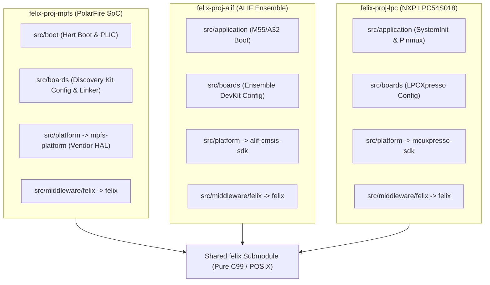
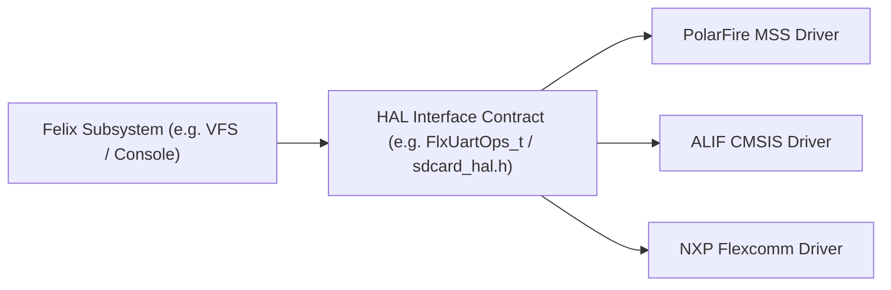

# Felix OS Cross-Architecture Portability Guidelines & Design Rules

## 1. Purpose & Scope

This document establishes the architectural rules and portability guidelines for **Felix OS**.

The core objective is to ensure that all development performed on the **Microchip PolarFire SoC** remains strictly hardware- and architecture-agnostic, enabling Felix to run seamlessly across diverse target architectures, including:
* **Microchip PolarFire SoC:** 64-bit RISC-V (RV64GC, E51 + 4x U54, 512KB LIM, 1GB DDR)
* **ALIF Ensemble (E6 / E7):** Hybrid 32-bit ARM (Dual Cortex-M55 + Dual Cortex-A32, SRAM/MRAM + HyperBus)
* **NXP LPC54S018:** 32-bit ARM Cortex-M4F (180 MHz, no MMU, internal SRAM + external SDRAM/SPI Flash)
* **Raspberry Pi (3 / 4 / 5 / CM4):** 64-bit ARM AArch64 (Cortex-A series, 1GB–8GB LPDDR4)

Any contribution, subsystem refactor, or driver addition to Felix **must** comply with these guidelines.

---

## 2. Target Platform Spectrum

| Target Platform | CPU Architecture | Word Size | Memory Model | Memory Protection | Target Felix Profile |
| :--- | :--- | :--- | :--- | :--- | :--- |
| **PolarFire SoC** | 1x E51 + 4x U54 (RV64GC) | 64-bit | 512KB LIM + 1GB DDR | Sv39 MMU / PMP (flat or virtual) | AMP: LIM control + DDR supervisor |
| **ALIF Ensemble (E6/E7)** | 2x Cortex-M55 + 2x Cortex-A32 | Hybrid (32-bit) | Internal SRAM/MRAM + HyperBus | MPU (M55) / VMSA MMU (A32) | AMP: M55 real-time + A32 Felix |
| **NXP LPC54S018** | Cortex-M4F (ARMv7E-M) | 32-bit | 360KB SRAM + Ext SDRAM | MPU only (No MMU) | Monolithic or external SPI/SDRAM |
| **Raspberry Pi (3/4/5)** | Cortex-A53 / A72 / A76 (ARMv8-A) | 64-bit | 1GB–8GB LPDDR4 | ARMv8-A VMSA MMU | Full Workstation / Diagnostic Host |

---

## 3. The Five Golden Rules of Portability

### Rule 1: The "Umbrella Project" Boundary & Submodule Isolation
The `felix` repository is a **pure OS middleware component**. It must have zero knowledge of specific board revisions, pin multiplexing, FPGA bitstreams, or silicon-vendor boot registers.



* **Where code belongs:**
  - Board startup, hart wake-up, clock tree configuration, and linker scripts belong strictly in the **umbrella wrapper project** (`src/boot/` and `src/boards/`).
  - Silicon vendor SDKs (Microchip `mpfs-platform`, Alif CMSIS, NXP MCUXpresso) are imported into the wrapper project as `src/platform/`.
  - When porting to a new chip, `felix` core remains unchanged. We create a new umbrella project (e.g., `felix-proj-alif`) that links to the same `felix` Git submodule.

---

### Rule 2: 32-bit vs. 64-bit Pointer & Storage Hygiene
Target MCUs like LPC54S018 and ALIF Cortex-M55 are **32-bit** (`sizeof(void*) == 4`), whereas PolarFire and Raspberry Pi are **64-bit** (`sizeof(void*) == 8`).

* **Strict Type Discipline:**
  - Always use `<stdint.h>` types (`uintptr_t`, `size_t`, `uint32_t`, `uint64_t`).
  - Never assume `sizeof(long) == sizeof(void*)` or `sizeof(void*) == 8`.
  - Cast pointer differences to `ptrdiff_t` or `uintptr_t`, never `int` or `long`.
* **64-bit Storage Offsets:**
  - File offsets and block storage addresses **must** remain 64-bit (`off_t`, `uint64_t`) across all architectures.
  - This guarantees that a 32-bit Cortex-M4 can read and write large SD cards (>4GB FAT32 / GPT) without 32-bit overflow.

---

### Rule 3: Zero ISA Intrinsics in Core Subsystems
Inline assembly, CPU control registers, and architecture-specific intrinsics are strictly forbidden inside:
* `felix/kernel/` (process manager, block manager, VFS)
* `felix/vfs/` (filesystem operations, node resolution)
* `felix/posix/` (POSIX shims and standard C library routines)
* `felix/shell/` (command interpreter and built-ins)

* **Abstraction via `felix/arch/include/cpu.h`:**
  All CPU-level operations must route through generic primitives:
  ```c
  void cpu_irq_enable(void);
  void cpu_irq_disable(void);
  uint32_t cpu_irq_save(void);
  void cpu_irq_restore(uint32_t flags);
  void cpu_wfi(void);
  void cpu_dmb(void);
  ```
  - For RISC-V: Implemented using `csrsi mstatus`, `csrci mstatus`, `wfi`, `fence`.
  - For ARM Cortex-M: Implemented using CMSIS `__enable_irq()`, `__disable_irq()`, `__WFI()`, `__DMB()`.
  - For ARM Cortex-A: Implemented using CPSR mask operations.

---

### Rule 4: Decoupled HAL Interface Contracts
Hardware drivers must never be called directly by kernel subsystems. Every peripheral interacts with Felix via an abstract **HAL Interface Contract**:



1. **Character Devices & Serial Console:**
   - Regulated by `FlxUartOps_t` (`tx_byte`, `rx_byte`, `is_tx_ready`, `is_rx_ready`).
   - The kernel resolves `/dev/console` without knowing whether the underlying silicon is a Microchip MMUART, an NXP Flexcomm USART, or an ARM PL011.
2. **Block Storage & SD/MMC:**
   - Regulated by [`drivers/sdcard_hal.h`](file:///c:/git/bar/felix/include/drivers/sdcard_hal.h) (`init`, `read_blocks`, `write_blocks`, `ioctl`, `is_inserted`).
   - The Block Manager and FatFs communicate only with this contract.

> [!IMPORTANT]
> Silicon-specific driver implementations (e.g. `sdcard_hal.c` and `mss_serial_port.c`) belong in the platform/board wrapper project, or cleanly isolated under `drivers/vendor/<vendor_name>/`, never intertwined with core kernel logic.

---

### Rule 5: Architecture-Agnostic Dynamic Loading (ELF)
Dynamic loading must support both MMU and No-MMU architectures:

1. **Position-Independent Executable (PIE) Model:**
   - Binaries are compiled with `-fPIE -pie` (supported natively by GCC for RISC-V, ARM Cortex-M, and AArch64).
   - Because PIE does not assume fixed virtual addresses, it runs identically on:
     - Flat physical SRAM/DDR (PolarFire LIM/DDR, LPC54S018 SDRAM, ALIF M55 SRAM).
     - Paged virtual memory (Raspberry Pi, ALIF Cortex-A32).
2. **Two-Tier ELF Loader Architecture:**
   - **Tier 1 (Generic Core - `flx_elf_loader.c`):** Parses ELF32 / ELF64 headers, locates `PT_LOAD` segments, allocates memory, and reads relocation tables.
   - **Tier 2 (Arch Relocation Plugs):**
     - `flx_elf_reloc_riscv.c`: Handles `R_RISCV_RELATIVE`, `R_RISCV_64`, `R_RISCV_JUMP_SLOT`.
     - `flx_elf_reloc_arm.c`: Handles `R_ARM_RELATIVE`, `R_ARM_ABS32`, `R_ARM_GLOB_DAT` (for LPC54 and ALIF).
     - `flx_elf_reloc_aarch64.c`: Handles `R_AARCH64_RELATIVE`, `R_AARCH64_GLOB_DAT` (for Raspberry Pi).

---

## 4. Multi-Hart & Heterogeneous Core (AMP) Guidelines

Several target chips (PolarFire SoC, ALIF Ensemble) feature heterogeneous cores:
* PolarFire: 1x E51 (RV64IMAC) + 4x U54 (RV64GC).
* ALIF: 2x Cortex-M55 (Real-time DSP/ML) + 2x Cortex-A32 (Application OS).

### Guidelines for Multi-Core Support:
1. **Per-Hart Local Storage (HLS):**
   - Kernel state, current PCB pointer, and interrupt context must be indexed per-hart/core via an opaque pointer or CPU-local register (`tp` on RISC-V, thread register or CMSIS base on ARM).
2. **Inter-Hart Communication (IPC):**
   - Inter-core messaging must use generic lockless ring buffers ([`felix/kernel/ring_buffer.h`](file:///c:/git/bar/felix/kernel/ring_buffer.h)) located in shared memory regions.
   - Cross-core signaling must use an abstract doorbell / software interrupt API (`ipc_notify_core(core_id)`).

---

## 5. Summary Checklist for Code Reviews

Before submitting or committing any change to `felix`:

- [ ] Does this file compile cleanly on both 32-bit and 64-bit targets?
- [ ] Are all integers with specific bit widths declared using `<stdint.h>` types?
- [ ] Are file sizes and offsets typed as `off_t` or `uint64_t`?
- [ ] Is the code completely free of direct assembly or CSR calls?
- [ ] Are hardware drivers interfaced through abstract HAL function pointer structs?
- [ ] Can this code be compiled and unit-tested in a host GCC environment (x86_64)?
